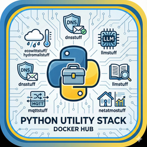

[](https://github.com/vroomfondel/somestuff/actions/workflows/mypynpytests.yml)
[](https://github.com/vroomfondel/somestuff/actions/workflows/buildmultiarchandpush.yml)


[](https://github.com/vroomfondel/somestuff)

# somestuff

Various small but useful Python utilities, experiments, and scripts collected in one place. Some are stand‑alone command‑line tools, others are small libraries or demo apps. A Docker image is provided to bundle the collection for easy, reproducible execution on multiple CPU architectures.

Quick links:
- Project Docker image: built from the repo‑root `Dockerfile` and published via multi‑arch builds
- CI: mypy + pytest, and a multi‑arch Docker build/push workflow (see badges above)

Contents overview (Python packages/modules):
- `broadlinkstuff`: Broadlink RM4 IR/RF blaster — learn/send codes and compute the full Coolix (Midea) climate matrix
- `dnsstuff`: SPF resolution helper and ipset updater for allow‑listing email senders (e.g. pcbway.com)
- `ecowittstuff`: simple client/types for Ecowitt weather station API
- `gcalstuff`: CLI tool for creating Google Calendar events with day‑view confirmation
- `hydromailstuff`: assemble and send "hydro"/weather summary emails, pulling data from MQTT/Netatmo
- `k3shelperstuff`: K3s kubeconfig credential synchronization, user-certificate issuing, a Keel image-drift checker and a version-pin drift checker
- `llmstuff`: helpers for working with LLM APIs and local OCR
- `mqttstuff`: tiny MQTT wrapper utility
- `dhcpstuff`: DHCP discover tool and diagnostic script for unwanted DHCP on Linux
- `netatmostuff`: Netatmo data fetch helper and deployment example
- `oepnvstuff`: GTFS‑Realtime coverage checker — validates whether an open GTFS‑RT feed actually carries real‑time data for configurable lines/stations, with watch mode, departure board and MQTT publishing
- `mqttwebstuff`: live web view onto arbitrary MQTT streams — mountable mapper plugins (filter/map per message), server‑side last‑value cache, SSE push to an htmx/PicoCSS frontend; ships an oepnv departure‑board plugin and a generic view (indented topic tree by default, flat JSON cards via `--view flat`)
- `ucmstuff`: monitor and control a Grandstream UCM6204 IP‑PBX — real‑time call events over WebSocket plus request/response control via the HTTPS API
- `uptimekumastuff`: provision, migrate and back up Uptime Kuma 2.x declaratively — idempotent YAML apply, Ansible module, full export/import, direct Socket.IO client
- Root helpers: `Helper.py`, configs (`config.yaml`, `config.py`, optional `config.local.yaml`), scripts
- Moved to standalone repos: `sipstuff` ([vroomfondel/sipstuff](https://github.com/vroomfondel/sipstuff)), `flickrdownloaderstuff` ([vroomfondel/flickrtoimmich](https://github.com/vroomfondel/flickrtoimmich), image `xomoxcc/flickr-download`)
- External packages: `mqttstuff` and `reputils` (via PyPI)

Standalone Docker image sub‑projects (each with own `Dockerfile` and `build.sh`):
- `tangstuff`: Tang server for LUKS/Clevis network‑bound disk encryption
- `mosquitto-2.1`: Mosquitto 2.1 MQTT broker with dynamic security
- `python314jit`: Python 3.14 base image with JIT support
- `python314pandasmultiarch`: Python 3.14 base image with pandas (multi‑arch)
- `f2bapistuff`: fail2ban plus a remote ban API (`xomoxcc/f2b-api`) — client sidecar and server in one image
- `postfixpgsqlstuff`: Postfix with PostgreSQL maps and policyd-spf for a Kubernetes mail pod
- `nfs-subdir-external-provisioner`: Kubernetes NFS provisioner (external submodule with local overlay)


## Getting started

Local prerequisites:
- Python 3.14+ recommended (repo and Docker image currently use `python:3.14-slim-trixie`)
- `pip` and a virtualenv of your choice

Install dependencies:
```bash
python -m venv .venv
source .venv/bin/activate
pip install -r requirements.txt -r requirements-dev.txt
```

Configuration:
- `config.yaml` contains sample/defaults. Do not commit secrets. If needed, create `config.local.yaml` to override locally (kept out of the image by default). Some modules read credentials/API keys from here (e.g. Ecowitt, Netatmo, MQTT, email settings). Adjust as needed before running modules that require it.

Run tests and type checks:
```bash
pytest -q
mypy .
```


## Modules and their usefulness

### dhcpstuff
DHCP discovery and diagnostic tools. Includes a Python DHCP Discover sender that displays all responses (including Proxy DHCP/PXE boot servers) and a bash diagnostic script for finding unwanted DHCP on physical interfaces (Ubuntu Server).

- CLI usage (requires root):
```bash
sudo python -m dhcpstuff -i eth0 -a efi64
```
- Flags: `-i` interface, `-t` timeout, `-m` MAC, `-a` PXE architecture (`bios`, `efi64`, `efi64-http`).
- The bash script `diagnose-dhcp.sh` checks cloud-init, netplan, systemd-networkd, NetworkManager, kernel cmdline, leases, and hooks for unwanted DHCP sources.
- No external dependencies (stdlib only).


### broadlinkstuff
Talk to Broadlink RM4 IR/RF blasters: address devices without a broadcast, learn IR/RF codes, send stored or raw codes, and compute Midea/Coolix air-conditioner codes instead of learning all 280 mode x fan x temperature combinations by hand.

- Entrypoint: `broadlinkstuff/broadlinkhelper.py`
- CLI usage:
```bash
python -m broadlinkstuff.broadlinkhelper devices
python -m broadlinkstuff.broadlinkhelper learn-ir Lounge
python -m broadlinkstuff.broadlinkhelper climate Lounge --mode heat --temp 23
python -m broadlinkstuff.broadlinkhelper special Lounge swing
```
- Config: own YAML files, independent of the repo-wide `config.yaml` — `broadlinkstuff/broadlink.yaml` (documented sample, committed) with `broadlink.local.yaml` (real devices, gitignored, taken from the current working directory) merged over it. No devices configured means every command falls back to a broadcast search; `discover` prints a ready-made YAML block to paste in.
- Logs go to stderr, payload (learned hex, config line, code listings) to stdout, so `learn-ir` can be piped.
- `selftest` verifies the Coolix generator against the learned reference codes; `decode` analyses any packet without touching hardware.


### dinogame (archived)
The grid pathfinding playground was removed from the tree; its last state is kept under the git tag `archive/dinogame`.


### dnsstuff (spf_ipset_updater)
Script to crawl SPF records (including nested `include:` chains) for one or more domains, resolve them to IPv4 ranges/addresses, then update an `ipset`. The ipset can be used by your MTA/firewall to allowlist specific SMTP sources. Originally motivated by receiving mails from pcbway.com while using country‑based IP blocks.

- CLI usage:
```bash
python -m dnsstuff.spf_ipset_updater [--ipset-name NAME] [--ipset-type TYPE] [--dry-run] [domain ...]
```
- Behavior:
  - Logs resolved IPv4s for each domain and combined total.
  - If running as root (`UID 0`), updates/swap‑refreshes the target ipset (default: `smtpallowlist`) using `pyroute2.ipset`.
  - If not root, it only reports and skips the ipset update step.
- Dependencies: `dnspython`, `pyroute2`.


### ecowittstuff
Small client types and functions to call the Ecowitt API and parse real‑time weather data into typed models.

- Main bits: `ecowittstuff/ecowittapi.py` defines `pydantic` models (e.g. `WeatherStationResponse`) and `get_realtime_data()`.
- Config required: `ecowitt.application_key`, `ecowitt.api_key`, `ecowitt.mac`, URLs in `config.yaml`.
- Example:
```bash
python -c "from ecowittstuff.ecowittapi import get_realtime_data; print(get_realtime_data())"
```


### gcalstuff
CLI tool for creating Google Calendar events via OAuth2 Desktop flow. Shows all existing events for the target day across all user calendars and requires explicit confirmation before creating the new event.

- Entrypoint: `gcalstuff/gcal_event.py`
- Setup: download OAuth2 Desktop credentials from Google Cloud Console to `~/.config/gcal/credentials.json`. On first run the browser‑based OAuth flow creates `~/.config/gcal/token.json`.
- CLI usage:
```bash
python -m gcalstuff.gcal_event "Meeting" 2025-07-15 14:00
python -m gcalstuff.gcal_event "Lunch" 2025-07-15 12:00 -d 90 --description "Team lunch"
```
- Dependencies: `google-auth`, `google-auth-oauthlib`, `google-api-python-client`.
- Docker: the initial OAuth flow opens a browser, so run it on the host first. After that, mount `~/.config/gcal` into the container (read‑write, since the token gets refreshed).


### hydromailstuff
Compose and send a status email summarizing recent measurements (e.g., water level, rain totals, ambient data). Pulls latest values from MQTT topics and Netatmo.

- Entrypoint: `hydromailstuff/hydromail.py` → `do_main_stuff()`.
- Needs config: email settings, MQTT (`mqtt.*`), and Netatmo credentials under `netatmo.*` in `config.yaml`.
- There are example deployment/cron YAMLs in `hydromailstuff/somestuff_hydromail_cronjob.yml`.


### llmstuff
Helper utilities to interact with LLM providers or local OCR pipelines.

- Files: `llmstuff/llmhelper.py`, `llmbatchhelper.py`, `ollamadeepseekocr.py`.
- Config: keys under `google.*` and `anthropic.*` in `config.yaml` if you want to call those providers.


### mqttstuff
Minimal MQTT wrapper(s) and helpers.

- File: `mqttstuff/mosquittomqttwrapper.py`.
- Config: `mqtt.*` and `mqtt_topics.*` in `config.yaml` (topics include metadata such as subscribe flag and default metadata).
- **⚠️ Warning:** this is now an external module (https://github.com/vroomfondel/mqttstuff) and included as library via pypi (https://pypi.org/project/mqttstuff/)


### netatmostuff
Read Netatmo measurements and provide a deployment example.

- Files: `netatmostuff/lnetatmo.py`, deployment example `somestuff_netatmo_deployment.yml`.
- Config: `netatmo.username/password/client_id/client_secret` (and optional module IDs) in `config.yaml`.


### k3shelperstuff
Helpers around a K3s/Kubernetes cluster: kubeconfig credential synchronization, client certificates for new users, a Keel image-drift checker and a version-pin drift checker.

- Entrypoints: `k3shelperstuff/update_local_k3s_keys.py`, `k8s_user_cert.py`, `keel_drift.py`, `pin_drift.py`
- CLI usage:
```bash
python -m k3shelperstuff.update_local_k3s_keys -H myserver -c my-k3s-context
python -m k3shelperstuff.k8s_user_cert extern-admin --role view -o /tmp/extern.yaml
python -m k3shelperstuff.keel_drift --drift-only --fix-command
python -m k3shelperstuff.pin_drift --updates-only
```
- `update_local_k3s_keys` fetches the kubeconfig from a K3s server via SSH and interactively syncs credentials/CA into `~/.kube/config`; `k8s_user_cert` issues a CSR-signed user certificate with optional (Cluster)RoleBinding and merges it into a kubeconfig; `keel_drift` compares the digest a pod runs against the digest its tag points at (exit 1 on drift); `pin_drift` checks version pins from `pin_drift.yml` against the newest GitHub/Forgejo release.
- Docker: mount `~/.kube` (and `~/.ssh` for the SSH fetch) read-write; `keel_drift` also runs in-cluster as a `Job`/`CronJob`.


### ucmstuff
Monitor and control a **Grandstream UCM6204** IP‑PBX from Python, over both of its interfaces: the WebSocket (`/websockify`) pushes real‑time events (`UCMEventClient`, auto‑reconnect + heartbeat, web user), the HTTPS API (`/api`) takes control requests such as `acceptCall`, `refuseCall`, `Hangup`, `dialExtension` and CDR queries (`UCM6204`, API user; `UCM6204Rest` adds a typed method per API action). `TrunkCallRouter` / `IncomingCall` route incoming trunk calls on a caller‑based branch.

- Files: `ucmstuff/ucm6204_api.py` (core + Typer CLI + `/healthz` for K8s probes), `ucm6204_api_rest.py`, `example_router.py`.
```bash
python -m ucmstuff.ucm6204_api --host ucm.example.lan --port 8089 \
  --web-user webuser --web-password '…' --api-user cdrapi --api-password '…' --trunk MyTrunk
```
- Deployment: `somestuff_ucm6204_deployment.yml` — outbound‑only pod, `/healthz` on 8070; real credentials in `*.local.*` (gitignored).
- Both interfaces negotiate a weak DH group, so the clients lower OpenSSL to `@SECLEVEL=1` automatically.


### uptimekumastuff
Provision, migrate and back up **Uptime Kuma 2.x** declaratively and idempotently instead of clicking monitors together in the web UI (nothing here monitors anything itself).

- `uptimekuma_client.py`: `KumaClient`, a direct Socket.IO client with fresh reads and idempotent `upsert_monitor`/`upsert_notification` (the PyPI `uptime-kuma-api` cannot write against 2.x and reads from a stale cache).
- `uptimekuma_apply.py`: desired state from YAML, re‑runnable, names instead of IDs, `--check` and `--prune`.
- `uptimekuma_monitor.py`: Ansible module for per‑monitor management with full check mode.
- `uptimekuma_simpleapi.py`: full export/import (monitors, notifications, tags, status pages) for backup and migration.
```bash
python -m uptimekumastuff.uptimekuma_apply -f kuma_state.local.yml --check
python -m uptimekumastuff.uptimekuma_simpleapi export --url https://kuma.example.lan --out state.local.json
```
- Credentials: `uptimekuma.local.env`, env vars or `--username`/`--password` (API keys only work for `/metrics`).


### oepnvstuff
Validate whether an open **GTFS‑Realtime** feed actually carries real‑time data for specific lines at a specific station — aggregators like gtfs.de merge whatever agencies deliver, often schedule only. One‑shot check or `--watch` poll loop (conditional HTTP requests, staleness detection via `FeedHeader.timestamp`), pluggable `on_*` handlers and an optional MQTT bridge (per‑line status, departure board, alerts, stale events).

- Entrypoint: `oepnvstuff/check_realtime.py` (Typer CLI); core in `monitor.py`, `gtfs_static.py`, `gtfs_realtime.py`, `mqtt_bridge.py`.
```bash
python -m oepnvstuff.check_realtime --lines "195,295" --station Ellerbek --show-stops
python -m oepnvstuff.check_realtime --watch --mqtt
```
- Every option is also an `OEPNV_*` env var; the static feed (~250 MB) is cached with HTTP validators. Exit codes: `0` realtime, `2` schedule only/stale, `3` line/stop unknown, `1` error.
- Deployment: `somestuff_oepnv_deployment.yml` with `OEPNV_STOP_ON_STALE=1` as self‑healing.


### mqttwebstuff
A live web view onto arbitrary **MQTT** streams: the server subscribes to the broker, runs every message through a *mapper plugin* (a plain Python file, in Kubernetes mounted via ConfigMap) and pushes rendered HTML fragments to the browsers via **Server‑Sent Events**; frontend htmx + PicoCSS, all assets vendored. A server‑side last‑value cache makes non‑retained streams browsable; without a plugin a generic mode shows any topic tree as an indented hierarchy (or flat JSON cards via `--view flat`).

- Core: `serve.py` (Typer CLI), `hub.py`, `plugin_api.py` (`ViewEvent` contract), `webapp.py` (FastAPI: `/`, `/stream`, `/healthz`).
```bash
python -m mqttwebstuff.serve --mapper mqttwebstuff/plugins/oepnv_view.py --mqtt-host broker.example.org
python -m mqttwebstuff.serve --mapper "" --topics 'nodered/#' --item-ttl 0 --mqtt-host broker.example.org
```
- Every option is also an `MQTTWEB_*` env var; deployment `somestuff_mqttweb_deployment.yml` (behind nginx‑ingress: no proxy buffering, long read timeout).


## Docker: build process, use, and usefulness

There is a single Docker image defined by the repo‑root `Dockerfile`. It is a plain **single‑stage** build on `python:3.14-slim-trixie` (the PJSIP/piper build stages left together with `sipstuff`, which is now a standalone repo):
- Installs system tools: `htop`, `procps`, `vim`, `tini`, `bind9-dnsutils`, `ipset`, `git`, `exiftool`, `iputils-ping`.
- Sets the `de_DE.UTF-8` locale and the `Europe/Berlin` timezone.
- Installs Python deps via `requirements.txt`.
- Creates a non‑root user (`pythonuser`, UID 1200, configurable via build args `UID`, `GID`, `UNAME`) and runs as that user.
- Copies the packages into `/app` and sets `PYTHONPATH=/app`.
- Accepts build‑time metadata args and exports them as envs: `GITHUB_REF`, `GITHUB_SHA`, `BUILDTIME`.
- Entrypoint is `tini --`, default `CMD` tails the log (adjust for your workload).


### Local build (simple)
```bash
docker build \
  --build-arg buildtime="$(date +'%Y-%m-%d %H:%M:%S %Z')" \
  -t xomoxcc/somestuff:python-3.14-slim-trixie \
  .
```

Run interactively (example):
```bash
docker run --rm -it \
  -v $(pwd)/config.yaml:/app/config.yaml:ro \
  xomoxcc/somestuff:python-3.14-slim-trixie \
  python -m dnsstuff.spf_ipset_updater pcbway.com
```

### Local build and multi‑arch push via buildx
This repo includes a helper script `build.sh` that:
- Logs in (expects `DOCKER_TOKENUSER` and `DOCKER_TOKEN` in env on first run)
- Ensures a `buildx` builder exists (and installs binfmt/qemu if needed)
- Builds locally and also performs a `docker buildx build --platform linux/amd64,linux/arm64 --push` with tags
- Writes local build logs to `docker_build_local.log`

Usage:
```bash
./build.sh            # multi‑arch build & push
./build.sh onlylocal  # local build only (no push)
```

The script also sets `DOCKER_CONFIG` to the bundled `docker-config/` directory so the builder state is isolated per‑repo. The primary tag is `xomoxcc/somestuff:python-3.14-slim-trixie` and an additional `:latest` tag is automatically added if missing.

## Standalone Docker Image Sub‑projects

Each sub‑project has its own `Dockerfile`, `build.sh`, and `README.md`:

### python314jit
Python 3.14 base image with JIT support for experimenting with Python 3.14's new features and performance.
- [Docker Hub](https://hub.docker.com/r/xomoxcc/python314-jit/tags)
- See `python314jit/README.md` for details.

### python314pandasmultiarch
Python 3.14 base image with pandas pre‑installed, built for multi‑arch (amd64 + arm64).
- [Docker Hub](https://hub.docker.com/r/xomoxcc/pythonpandasmultiarch/tags)
- See `python314pandasmultiarch/README.md` for details.

### mosquitto-2.1
Mosquitto 2.1 MQTT broker with dynamic security plugin, multi‑arch build.
- [Docker Hub](https://hub.docker.com/r/xomoxcc/mosquitto/tags)
- See `mosquitto-2.1/README.md` for details.

### tangstuff
Tang server for LUKS/Clevis network‑bound disk encryption (NBDE), enabling automatic disk unlock on trusted networks.
- [Docker Hub](https://hub.docker.com/r/xomoxcc/tang/tags)
- See `tangstuff/README.md` for details.

### f2bapistuff
fail2ban 1.1.0 plus a remote ban API in one image: the client side runs as a fail2ban sidecar whose bans are posted to the API, the server side owns the jails `remote-<client>` and the host firewall.
- [Docker Hub](https://hub.docker.com/r/xomoxcc/f2b-api/tags)
- See `f2bapistuff/README.md` for details.

### postfixpgsqlstuff
Postfix with PostgreSQL maps and the SPF policy daemon; configuration is mounted by the deployment.
- [Docker Hub](https://hub.docker.com/r/xomoxcc/postfix-pgsql/tags)
- See `postfixpgsqlstuff/README.md` for details.

### nfs-subdir-external-provisioner
Kubernetes NFS external provisioner (git submodule from upstream). Local modifications are stored in `overlays/nfs-subdir-external-provisioner/` and applied at build time.
- Build: `make build-nfs` (applies overlay, then builds)
- See upstream repo for documentation.

## Versioning
This is a living collection; no strict semantic versioning. Expect occasional breaking changes. A rough, humorous version might be “-0.42”.


## License
This project is licensed under the LGPL where applicable/possible — see [LICENSE.md](LICENSE.md). Some files/parts may use other licenses: [MIT](LICENSEMIT.md) | [GPL](LICENSEGPL.md) | [LGPL](LICENSELGPL.md). Always check per‑file headers/comments.


## ⚠️ Note

This is a development/experimental project. For production use, review security settings, customize configurations, and test thoroughly in your environment. Provided "as is" without warranty of any kind, express or implied, including but not limited to the warranties of merchantability, fitness for a particular purpose and noninfringement. In no event shall the authors or copyright holders be liable for any claim, damages or other liability, whether in an action of contract, tort or otherwise, arising from, out of or in connection with the software or the use or other dealings in the software. Use at your own risk.