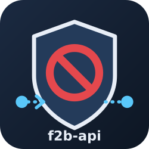

[](https://github.com/vroomfondel/somestuff/tree/main/f2bapistuff)

# f2b-api: fail2ban with a remote ban API

One Debian trixie image (fail2ban 1.1.0, iptables-nft, msmtp, python3-typer) for both ends of a remote-ban setup: a fail2ban **client** that cannot block anything itself (a container behind a proxy) and a **server** that owns the firewall of the machine the attackers actually reach. The client's bans are mirrored into a jail on the server, one jail per client.

## Roles (entrypoint.sh)

| `CMD`      | Role                                                                                                                                                    |
|------------|---------------------------------------------------------------------------------------------------------------------------------------------------------|
| `fail2ban` | fail2ban-server. Client: `F2B_HUB_SYNC=1` and a mounted `/etc/f2b-hub/{url,token}`. Server: the `remote-<client>` jails, `NET_ADMIN`, host network      |
| `api`      | `f2b_api.py serve --listen <addr> --port <port>`: the HTTP API, talks to the server's fail2ban only through its socket directory, needs no capabilities |

Environment for `fail2ban`:

| Variable            | Default                              | Meaning                                                                                      |
|---------------------|--------------------------------------|----------------------------------------------------------------------------------------------|
| `F2B_LOGTARGET`     | `STDOUT`                             | fail2ban log target; a file when `recidive` should read it                                   |
| `F2B_DBFILE`        | `/var/lib/fail2ban/fail2ban.sqlite3` | ban database, mount it to keep bans across restarts                                          |
| `F2B_DBPURGEAGE`    | `8d`                                 | how long finished bans stay in the database                                                  |
| `F2B_TOUCH`         | –                                    | `path[:uid] ...`: log files created before the start (a missing file fails the whole server) |
| `F2B_HUB_SYNC`      | `0`                                  | `1` starts `f2b_hub_sync.py` next to fail2ban (client side)                                  |
| `F2B_SYNC_INTERVAL` | `300`                                | seconds between full reconciles                                                              |
| `F2B_SYNC_TRIGGER`  | `/run/f2b-hub-resync`                | file whose presence triggers a reconcile within 5 s                                          |

## Client side

Jails use `banaction = hubapi`: every ban is posted at once to `POST /f2b/v1/ban`, with `/etc/f2b-hub/url` and `/etc/f2b-hub/token` mounted read-only. Unbans are **not** posted; they only touch the trigger file, and `f2b_hub_sync.py` posts the union of all local jails to `POST /f2b/v1/state` within 5 s, and every `F2B_SYNC_INTERVAL` anyway. The server has one jail per client, the client several: a direct unban at the end of one jail's ban would free an address another jail (e.g. `recidive`) still holds. The periodic reconcile also heals bans the server missed. `f2b_hub_sync.py once` pushes the list a single time.

Filters shipped: `dovecot24` (Dovecot 2.4 file log format) and `remote-ban` (for the server jails).

```ini
[DEFAULT]
backend = polling
banaction = hubapi
banaction_allports = hubapi
action = %(action_)s

[dovecot]
enabled = true
filter = dovecot24
logpath = /var/log/mail/dovecot.log
```

## Server side

Jails `remote-<client>` (`filter = remote-ban`, `logpath = /dev/null`, `backend = polling`, a real `banaction`), fed only by the API. Run two containers from this image: `fail2ban` with `NET_ADMIN`/`NET_RAW` in the host network owning the jails, and `api` without capabilities sharing only fail2ban's socket directory (`/run/fail2ban`). Never mount the host's own fail2ban socket into the API container.

| File                   | Content                                                                     |
|------------------------|-----------------------------------------------------------------------------|
| `/etc/f2b-api/tokens`  | `<client> <token>` per line; tokens of at least 32 characters; `#` comments |
| `/etc/f2b-api/protect` | networks that are never banned, one IPv4 address or CIDR per line           |

Only global IPv4 addresses outside the protect list are accepted; private, reserved and multicast addresses are rejected with 422.

## API

| Method | Path            | Body             | Effect                                      |
|--------|-----------------|------------------|---------------------------------------------|
| `POST` | `/f2b/v1/ban`   | `{"ip", "jail"}` | `fail2ban-client set remote-<client> banip` |
| `POST` | `/f2b/v1/unban` | `{"ip"}`         | `… unbanip`                                 |
| `POST` | `/f2b/v1/state` | `{"ips": [...]}` | reconcile the jail to exactly this set      |
| `GET`  | `/f2b/v1/state` | –                | the client's banned addresses               |

Authentication: `Authorization: Bearer <token>`; each client sees only its own jail.

## Tags

`<fail2ban version>-<build>` (e.g. `1.1.0-1`) and `latest`. Pin the versioned tag: the server container holds `NET_ADMIN`.

Source: [vroomfondel/somestuff/f2bapistuff](https://github.com/vroomfondel/somestuff/tree/main/f2bapistuff)
